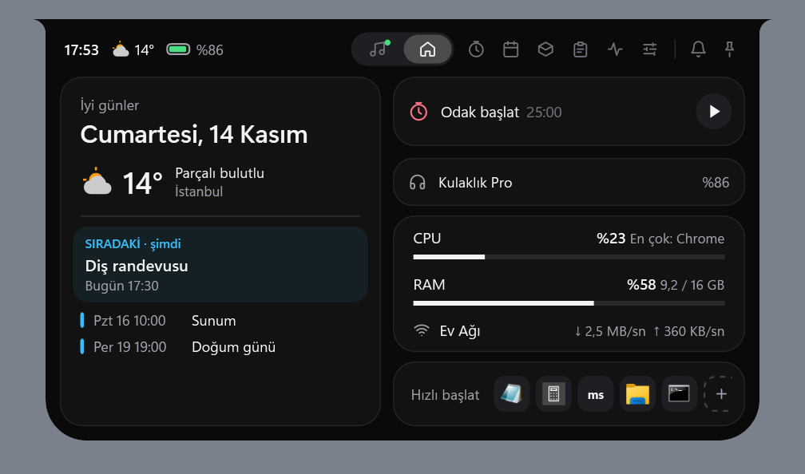
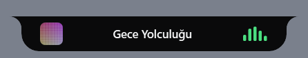
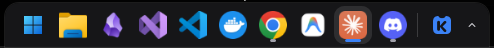
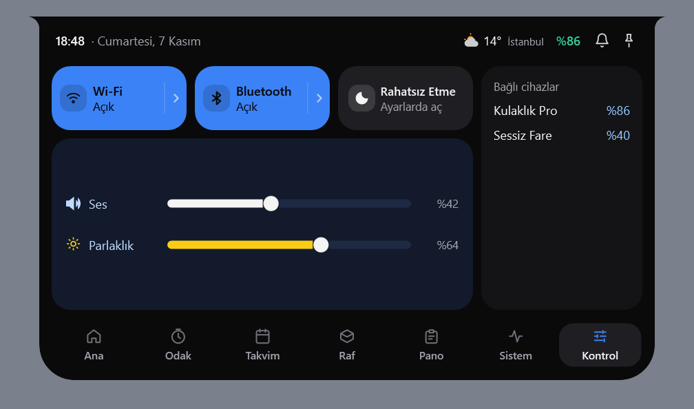
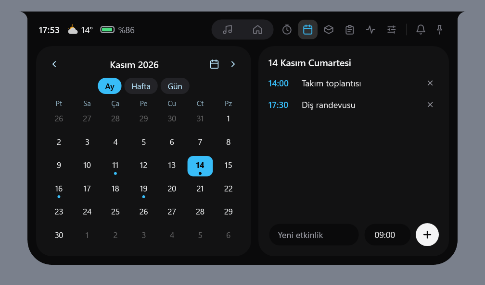
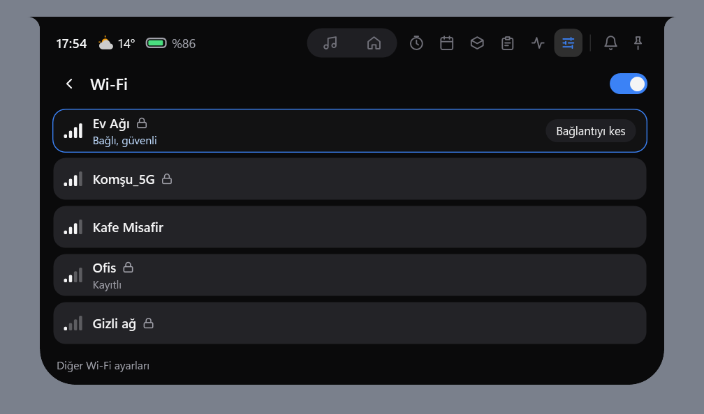
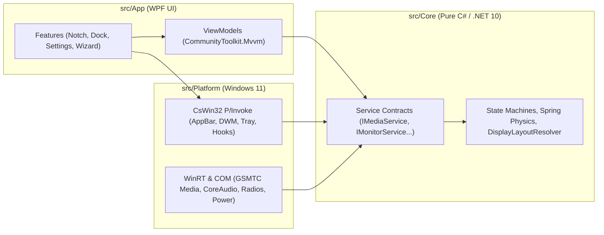

<div align="center">

<picture>
  <source media="(prefers-color-scheme: dark)" srcset="assets/branding/koy-horizontal-white.svg">
  <source media="(prefers-color-scheme: light)" srcset="assets/branding/koy-horizontal-color.svg">
  
</picture>

<br />
<br />

**English** · [Türkçe](README.tr.md)

**A lightweight, zero-browser, spring-animated Notch and smart desktop Dock for Windows 11.**

[](https://github.com/koyhq/koy/actions/workflows/ci.yml)
[](https://github.com/koyhq/koy/releases/latest)
[-0078D4)](https://github.com/koyhq/koy)
[](https://dotnet.microsoft.com/)
[](LICENSE)

[Download (Releases)](https://github.com/koyhq/koy/releases/latest) · [Website](https://koyhq.github.io/koy) · [Architecture & Plan (Turkish)](docs/PLAN.md) · [UI Design (Turkish)](docs/DESIGN.md) · [Contribute](CONTRIBUTING.md)

<br />



<sub>Home panel with the notch open: now playing, headphone battery, system and network, quick launch.</sub>

</div>

---

## Screenshots

| | |
| :---: | :---: |
| <br><sub>Closed notch: cover art and waveform while music plays</sub> | <br><sub>Dock: replaces the Windows taskbar</sub> |
| <br><sub>Control Center: Wi-Fi, Bluetooth, volume, brightness</sub> | <br><sub>Calendar: month, week and day views, events</sub> |
| <br><sub>Wi-Fi list: network selection like in Windows</sub> | |

<sub>Notch images were rendered with sample data (`tools/Koy.UiSnapshots`); the dock image is from a real screen. The app UI is available in English and Turkish.</sub>

---

## Why Koy?

Most desktop customization tools (those based on Electron, Tauri or WebView2) start a separate browser process for each window, consuming hundreds of megabytes of RAM and constant background CPU.

**Koy** is built directly on **.NET 10, WPF, WinRT and CsWin32**, with no browser dependency:

| Feature | Koy | Browser-Based Alternatives (WebView2 / Electron) |
| :--- | :--- | :--- |
| **Process Model** | **Single process (`Koy.exe`)**, shared resources | Separate browser subprocesses per window |
| **Rendering** | **Software rendering (`SoftwareOnly`)**: no GPU driver bloat (~135 MB) | Constant GPU composition and VRAM usage |
| **Idle CPU** | **0% CPU**: `CompositionTarget.Rendering` is detached when the `Spring` settles | Constantly running CSS/JS timers |
| **Service Lifecycle** | **Lazy initialization**: no network or COM setup until a panel is opened | All services loaded at startup |
| **Taskbar Safety** | **Automatic recovery (`Restore`)** on crash, update and uninstall | Taskbar disappears when the process is killed |

---

## Key Features

### 1. Spring-Animated Notch & OSD HUD
Positioned at the top center of the screen (`Top = 0`) with a custom `NotchShape` vector geometry that has concave top ears:
- **Idle State (236×34 px):** Clock on the left, battery percentage on the right; if the Control panel is enabled, Wi-Fi and Bluetooth status icons in the middle (dimmed and struck through when off, show status on hover, open the Control tab on click; no icon appears if the radio is missing). While music plays, album art (22×22 px) on the left and a 4-bar waveform icon that uses **0% CPU** on the right.
- **OSD HUD Indicators (260×40 px):** A smooth indicator appears in the notch for 1.5 seconds when system volume or display brightness changes (white `#F4F4F5` for volume, yellow `#FACC15` for brightness). Wired to system volume (CoreAudio) and brightness (WMI / DDC-CI) changes; each can be turned off separately in the Koy window. The brightness indicator only works on displays whose brightness can be read.
- **Battery and Bluetooth Notifications:** Plugging in or unplugging the charger, below 20% and 10%, full battery; when a paired Bluetooth device connects or disconnects, its name and battery briefly appear in the notch.
- **Expanding 7-Tab Panel:** Switch between panels from the tab bar at the bottom (Home, Focus, Calendar, Shelf, Clipboard, System, Control; those enabled in settings, in the configured order) or with the mouse wheel.
  - **Music:** Cover art, track and artist info, an interactive timeline (`Seek`) and multi-session switching for Spotify, YouTube (Edge/Chrome/Firefox) and media players via `GlobalSystemMediaTransportControls`.
  - **Calendar & Pomodoro:** Monday-first month view and a state-machine **Pomodoro** timer with work, short break and long break (spring-bounce Peek notification when time is up).
  - **Shelf:** Drag and drop files or text onto the notch (`%AppData%\Koy\shelf.json`). When you drag a file over the notch, it opens by itself and switches to the Shelf tab.
  - **Control Center:** CoreAudio volume, WMI (built-in) and DDC/CI (external monitor) hardware brightness sliders, Do Not Disturb status, and Wi-Fi and Bluetooth toggles that really turn them on and off (if the radio is missing, off, or Windows does not allow it, the tile says so and opens Windows settings).
  - **Status:** Battery percentage (the idle notch indicator is hidden on desktops with no battery), charging status and keyless **Open-Meteo** weather (cached for 30 minutes).

### 2. Smart Desktop Dock
Not an ordinary copy of the Windows taskbar: it hands the clock, battery and network indicators over to the notch and focuses only on apps and window management:
- **Two Layout Styles:**
  - **Floating Capsule (default):** 60 px tall, 10 px above the bottom, 18 px corner radius. Layout: *Start → Apps (dot/line indicators) → Separator → Folders (Downloads) & Minimized Windows → Separator → Koy Menu*.
  - **Full Width (Windows style):** 48 px, attached to the screen edge with no gap. Start and now playing on the left, apps in the middle (same running indicators as the capsule), Koy menu and a small tray on the right. Only two modes: "Always show" (reserves exactly 48 px) and "Auto hide".
- **Dock Folders:** Drag a pinned app onto the middle of another and hold to make a folder; the folder shows a 2×2 preview and opens in a glass panel on click. Rename, remove from folder, disband.
- **Compact Tray and Press Feel:** The tray is a narrow arrow next to the Koy button; icons dip slightly when pressed and spring back on release.
- **Window Proximity Behaviors (`DockProximityMode`):**
  - **Dock Down (`DockDown`, default):** When a normal-sized window gets close, the dock settles onto the bottom edge (thins from 60 px to 46 px, only the top corners stay rounded); it floats again when the window moves away.
  - **Dodge / Intellihide (`Dodge`):** When a window gets close or is maximized, the dock slides below the screen; it comes back when the mouse reaches the bottom edge.
  - **Reserve Space (`ReserveSpace`):** Reserves 46 px of the work area with `SHAppBarMessage`; maximized windows end exactly above the dock (the reserved strip is full width, so both sides of the capsule stay empty).
  - **Always Hidden (`AlwaysHidden`):** Appears only when the mouse reaches the bottom edge of the screen.
- **Live DWM Window Preview:** Hovering over an icon for 400 ms shows a real-time window preview with `DwmRegisterThumbnail` (registered on the top-level window; retried on the next layout if registration fails).
- **System Tray:** While the Windows taskbar is hidden, icons of background apps (Discord, OneDrive, etc.) live in a window opened from the up-arrow button on the dock; left and right clicks are forwarded to the app. Koy sets up its own `Shell_TrayWnd` window at this time and forwards every registration to Windows too, so the Windows tray comes back intact if Koy exits, crashes or is paused. While the taskbar is visible (or "Show system tray in dock" is off on the Dock page), the Windows tray is not touched. Contributed by xdaxer (#11).
- **Open from the Bottom Edge, and Fullscreen:** When a maximized window hides the dock, the dock appears after the mouse rests on the bottom edge for ~300 ms (with no button pressed); this can be turned off in settings. In games, F11 browsers and fullscreen video the dock never appears. Fullscreen is determined per monitor by combining the Windows notification, the absence of a title bar and covering the monitor.
- **Pinned App Order:** The order is kept in Koy's settings; on first launch it is seeded from Windows, then icons are reordered by dragging on the dock. Newly pinned apps are added to the end.
- **Recents:** The stack icon on the dock lists up to 10 files from the Windows Recent folder (read only on click); it can be turned off on the Dock page.
- **Taskbar Watchdog:** As long as the dock hides the taskbar, a small helper process (`Koy.Watchdog.exe`, Native AOT) watches Koy; if Koy is killed from Task Manager, it brings the taskbar back by itself.
- **Z-Order Stability:** The order of unpinned running app icons does not jump while switching windows with Alt+Tab (`_stableUnpinnedOrder`).

### 3. Multi-Monitor Isolation
- **Per-Display Windows & DPI:** The **Displays** page in the Koy window shows connected monitors as a map; the notch and dock are turned on and off separately for each display, and you choose what to show on newly connected displays. Every enabled monitor has its own `NotchWindow` and `DockWindow` instance, drawn at that display's Per-Monitor DPI scale. *Note: not yet manually tested on a real multi-monitor, mixed-DPI setup.*
- **Independent Fullscreen Detection:** When a game or video goes fullscreen on a side display, **only Koy on that display hides**; the Notch and Dock on the main display keep running (the `Win+Shift+S` snipping tool is filtered out).
- **Dynamic Hot-Plugging (`WM_DISPLAYCHANGE`):** Windows are created and repositioned automatically when a monitor is connected or removed or the resolution changes.
- **Secondary Taskbars:** With multiple displays, both the main (`Shell_TrayWnd`) and secondary (`Shell_SecondaryTrayWnd`) Windows taskbars are managed in sync.

### 4. Koy Window, Bottom-Right Menu & Setup Wizard
- **880 px Koy Window:** Eight modular settings pages (*General, Notch, Dock, Displays, Appearance, Shortcuts, Performance, About*). Closing the window does not quit Koy; it only hides the settings view.
- **Emergency Taskbar Recovery:** The *Dock* and *About* pages have an emergency button that restores the Windows taskbar with one click.
- **Bottom-Right System Menu (320 px):** Toggle the Notch and Dock instantly, open the Koy window, **pause for 1 hour** (the notch and dock stop and the taskbar comes back; resumes after an hour or when pressed again) and quit the app. Quit exists only in this menu and in the "Quit Koy" button in the Koy window.
- **Global Shortcuts:** Real registration via `RegisterHotKey`; defaults for the notch, shelf, dock, Koy menu and play/pause are `Ctrl+Alt+N/R/D/K/Space` (no conflict with the `Win+letter` shortcuts of Windows). Change them by capturing keys on the Shortcuts page; combinations reserved by Windows or held by another app are reported to the user.
- **Dark / Light Theme:** System, Dark or Light; accent color, solid or translucent material, corner radius and animation speed are set on the Appearance page. "Reduce animations" and battery saver turn off motion.
- **Uninstall Koy:** The button on the About page opens a Koy-style confirmation ("Keep my settings" checked by default), restores the taskbar and starts the Velopack uninstaller. Enabled only in the installed version. Uninstalling from the Windows "Installed apps" page also restores the taskbar, removes the startup entry and keeps your settings.
- **Live Language Switching (TR / EN):** Switch between Turkish and English instantly, without restarting the app.

### 5. Known Gaps
To be honest about the current state, the following do not exist yet or have not been verified.
- **Memory:** Our idle target is 100–150 MB private (up to 200 MB accepted with multiple displays or open panels). The last measurement (2026-11-06, single monitor, notch + dock + tray enabled) was 63.9 MB private; it has not been measured again since the dock/tray bundle (watchdog process, recents, pinned order, edge opening). Details are in [`docs/MEMORY.md`](docs/MEMORY.md).
- **Dock folders:** Shipped in 0.2.0; manual testing is ongoing.
- **UWP pins from Windows** (such as Spotify and WhatsApp) are not shown on the dock yet.
- **Multi-monitor:** Not manually tested on mixed-DPI hardware or with the secondary taskbar AppBar.
- **Not available yet:** Showing Windows notifications in the notch, code signing (SmartScreen warning). For the order of work, see [`docs/ROADMAP.md`](docs/ROADMAP.md).
- **Not verified:** Animation smoothness, how the translucent material looks on real devices, live update when the system theme changes, an end-to-end run of the in-app uninstall flow on a real installation.

---

## Installation and Verification

### Ready-Made Package (Recommended)
1. Download the latest release from the [**GitHub Releases**](https://github.com/koyhq/koy/releases/latest) page:
   - **`Koy-win-Setup.exe`**: One-click Velopack installer (supports automatic updates).
   - **`Koy-win-Portable.zip`**: Portable archive with no installation required.
2. You can verify the integrity of the downloaded file with `SHA256SUMS.txt`:
   ```powershell
   Get-FileHash .\Koy-win-Setup.exe -Algorithm SHA256
   ```

### Signing, SmartScreen and Updates

Koy's installer and updates are **not code-signed yet**. Therefore:

- **SmartScreen warning:** On first run Windows may say "Windows protected your PC". If you downloaded the file only from the [GitHub Releases](https://github.com/koyhq/koy/releases) page, you can continue with **"More info" → "Run anyway"**. Do not run a Koy file that came from another site, a mirror or a shared link.
- **What `SHA256SUMS.txt` proves:** That the download arrived intact and complete. Because it sits on the same release page as the file, it does not prove who published the file; that assurance comes from the GitHub repository itself.
- **Automatic updates:** Installed Koy only downloads releases from this repository's GitHub Releases page over HTTPS. Velopack compares each package with the SHA hash in the release feed; a package that does not match is not installed. Updates are applied when Koy closes. If you prefer, you can turn off automatic checks in Settings → General.
- **Release pipeline:** Releases are built only on GitHub Actions, after tests pass. Actions in use are pinned to commit hashes; force-pushing to `main`, deleting the branch, and moving or deleting published `v*` tags are blocked by repository rules.
- **Plan:** Free code signing for open source projects (SignPath Foundation) will be evaluated. Once signing arrives, the SmartScreen warning will fade over time and updates will be verified by signature as well.

### Building from Source

**Requirements:** Windows 11 (22H2 / build 22621+) and the [.NET 10 SDK](https://dotnet.microsoft.com/download/dotnet/10.0)

```powershell
# 1. Clone the repository
git clone https://github.com/koyhq/koy.git
cd koy

# 2. Build and run the unit tests
dotnet build Koy.slnx -c Release -warnaserror
dotnet test Koy.slnx -c Release

# 3. Start the app
dotnet run --project src/App

# 4. (Optional) Build the Velopack installer and portable ZIP packages
powershell -ExecutionPolicy Bypass -File scripts\pack.ps1 -Version 0.1.0
```

---

## Architecture

Koy uses a three-layer architecture whose boundaries are enforced at compile time:



```text
koy/
├── src/
│   ├── Core/          # Pure C# (net10.0). No WPF, Win32 or WinRT. Spring physics, state machines, settings.
│   ├── Platform/      # Windows 11 API implementations (CsWin32 NativeMethods.txt & WinRT). No WPF.
│   └── App/           # WPF UI, thin ViewModels, 8-page KoyWindow, vector icons and .resx language files.
├── tests/
│   └── Core.Tests/    # xUnit unit tests (Spring, NotchController, DockPositionResolver, Pomodoro, shortcuts, display layout, uninstall, etc.).
├── tools/
│   └── Koy.UiSnapshots/ # Helper that renders the UI to PNG without showing it on screen (visual verification).
├── assets/branding/   # Koy Badge (Concept C) vector SVG, PNG and multi-layer ICO brand assets.
├── docs/              # PLAN.md, DESIGN.md, ROADMAP.md, MEMORY.md and an offline design gallery.
└── scripts/           # pack.ps1 (Velopack packager), measure-memory.ps1 (memory measurement), generate-icons.py (brand icons).
```

---

## Documents and Guides

Internal documents under `docs/` are written in Turkish.

- [**Architecture and Technology Plan (`docs/PLAN.md`)**](docs/PLAN.md)
- [**UI Design Document (`docs/DESIGN.md`)**](docs/DESIGN.md) & Offline Gallery (`docs/design/index.html`)
- [**Roadmap (`docs/ROADMAP.md`)**](docs/ROADMAP.md)
- [**Memory Measurements (`docs/MEMORY.md`)**](docs/MEMORY.md)
- [**Contributing and Coding Rules (`CONTRIBUTING.md`)**](CONTRIBUTING.md)
- [**Changelog (`CHANGELOG.md`)**](CHANGELOG.md)
- [**Security Policy (`SECURITY.md`)**](SECURITY.md)

---

## Acknowledgements

Koy was born from the ideas of two projects; no code, images or text were taken from either, and everything was written from scratch:

- [**Nectar**](https://github.com/kua8/Nectar): the idea of a spring-animated notch at the top of the screen.
- [**Seelen UI**](https://github.com/eythaann/Seelen-UI): a floating dock that replaces the taskbar, and smart placement that reacts when a window gets close.

The difference: both run on a browser engine (WebView2/Tauri), Koy does not. A single process, directly native C# (.NET 10) / WPF, 0% idle CPU and a 100–150 MB memory target.

---

## License

This project is licensed under the **GNU General Public License v3.0 (GPLv3)**. See the [`LICENSE`](LICENSE) file for details.
