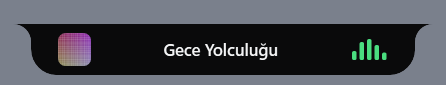
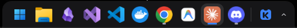
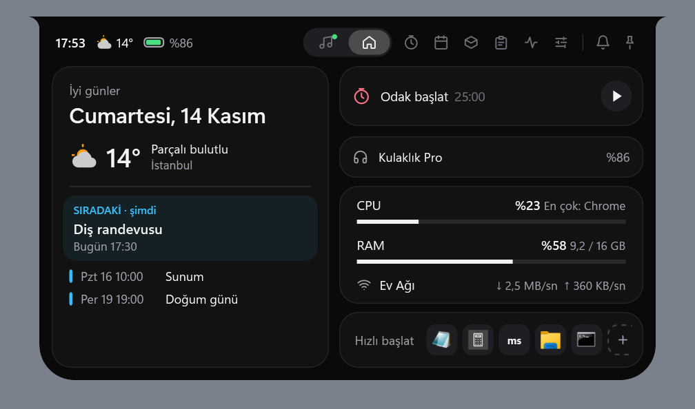
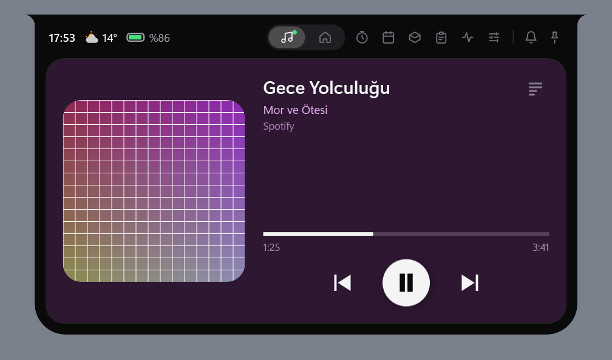
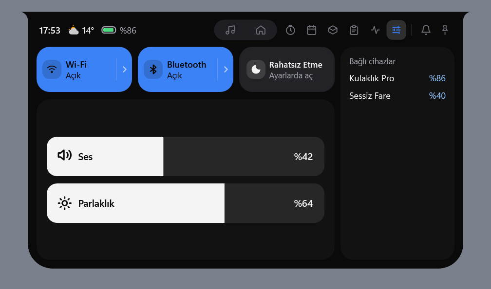
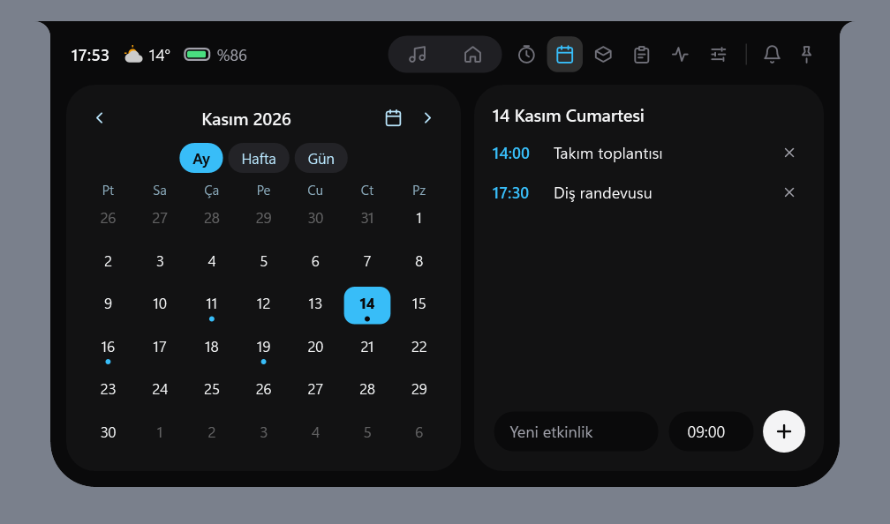
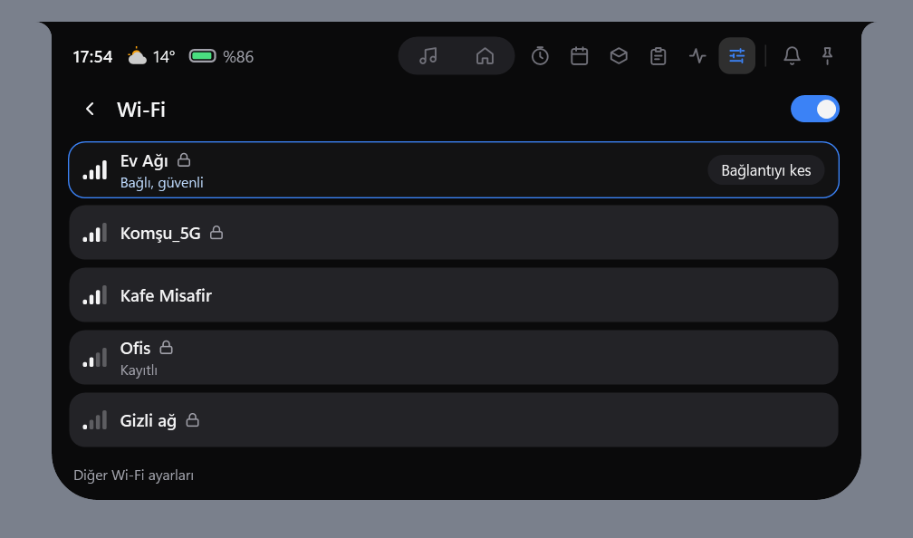
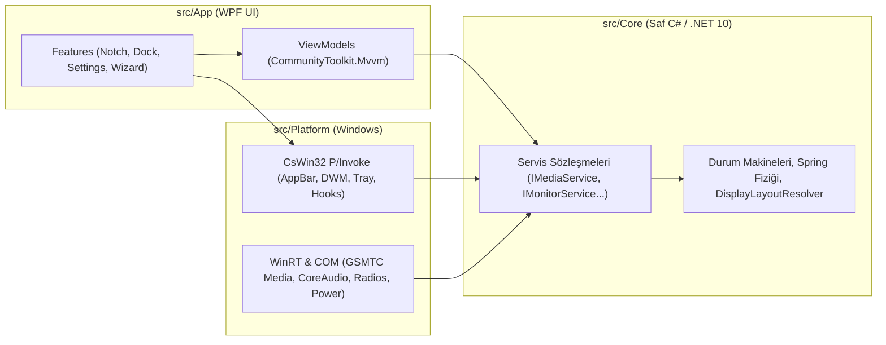

<div align="center">

<picture>
  <source media="(prefers-color-scheme: dark)" srcset="assets/branding/koy-horizontal-white.svg">
  <source media="(prefers-color-scheme: light)" srcset="assets/branding/koy-horizontal-color.svg">
  
</picture>

<br />
<br />

[English](README.md) · **Türkçe**

**Windows 10 ve 11 için hafif, yay fiziği animasyonlu Çentik (Notch) ve akıllı masaüstü Dock'u.**

[](https://github.com/koyhq/koy/actions/workflows/ci.yml)
[](https://github.com/koyhq/koy/releases/latest)
[-0078D4)](https://github.com/koyhq/koy)
[](https://dotnet.microsoft.com/)
[](LICENSE)

[İndir (Releases)](https://github.com/koyhq/koy/releases/latest) · [Web Sitesi](https://koyhq.github.io/koy) · [Mimari & Plan](docs/PLAN.md) · [Arayüz Tasarımı](docs/DESIGN.md) · [Katkıda Bulun](CONTRIBUTING.md)

<br />


<sub>22 saniyelik tanıtım: çentik üst kenardan yayla açılır, Takvim ve Kontrol Merkezi, Raf'a dosya bırakma ve dock.</sub>

</div>

---

## Ekran Görüntüleri

| | |
| :---: | :---: |
| <br><sub>Kapalı çentik: müzik çalarken kapak ve dalga</sub> | <br><sub>Dock: Windows görev çubuğunun yerine</sub> |
| <br><sub>Ana: tarih ve hava, sıradaki etkinlikler, odak sayacı, kulaklık pili, sistem ve ağ, hızlı başlat</sub> | <br><sub>Müzik: kapak, ilerleme ve kontroller kendi sayfasında</sub> |
| <br><sub>Kontrol Merkezi: Wi-Fi, Bluetooth, ses, parlaklık</sub> | <br><sub>Takvim: ay, hafta ve gün görünümü, etkinlikler</sub> |
| <br><sub>Wi-Fi listesi: Windows'taki gibi ağ seçimi</sub> | |

<sub>Çentik görüntüleri örnek verilerle çizildi (`tools/Koy.UiSnapshots`); dock görüntüsü gerçek ekrandan.</sub>

---

## Neden Koy?

Masaüstü özelleştirme araçlarının çoğu (Electron, Tauri veya WebView2 tabanlı olanlar) her pencere için ayrı bir tarayıcı süreci başlatarak yüzlerce megabayt RAM ve sürekli arka plan işlemcisi tüketir.

**Koy**, sıfır tarayıcı bağımlılığıyla doğrudan **.NET 10, WPF, WinRT ve CsWin32** üzerine inşa edilmiştir:

| Özellik | Koy | Tarayıcı Tabanlı Alternatifler (WebView2 / Electron) |
| :--- | :--- | :--- |
| **Çalışma Modeli** | **Tek süreç (`Koy.exe`)**, paylaşımlı kaynaklar | Pencere başına ayrı tarayıcı alt süreçleri |
| **Çizim Motoru** | **Yazılımla çizim (`SoftwareOnly`)** — GPU sürücü şişkinliği (~135 MB) yok | Sürekli GPU kompozisyonu ve VRAM tüketimi |
| **Boşta İşlemci (`Idle CPU`)** | **%0 CPU** — `Spring` durunca `CompositionTarget.Rendering` çözülür | Sürekli çalışan CSS/JS zamanlayıcıları |
| **Servis Yaşam Döngüsü** | **Tembel (Lazy) ilklendirme** — paneller açılana kadar ağ/COM kurulmaz | Açılışta tüm servislerin yüklenmesi |
| **Görev Çubuğu Güvenliği** | Çökme, güncelleme ve kaldırma anında **otomatik kurtarma (`Restore`)** | Süreç öldürüldüğünde görev çubuğunun kaybolması |

---

## Temel Özellikler

### 1. Yay Animasyonlu Çentik (Notch) & OSD HUD
Ekranın üst ortasında (`Top = 0`), içbükey (*concave*) üst kulaklara sahip özel `NotchShape` vektör geometrisiyle konumlanır:
- **Boşta Durum (236×34 px):** Solda saat, sağda pil yüzdesi; Kontrol paneli açıksa ortada Wi-Fi ve Bluetooth durum simgeleri (kapalıyken soluk ve üstü çizili, üzerine gelince durum yazar, tıklayınca Kontrol sekmesi açılır; radyo yoksa simge çıkmaz). Müzik çalarken solda albüm kapağı (22×22 px), sağda **%0 CPU** harcayan 4 çubuklu dalga ikonu.
- **OSD HUD Göstergeleri (260×40 px):** Sistem sesi veya ekran parlaklığı değiştiğinde 1,5 saniye boyunca çentikte beliren akıcı gösterge (ses için beyaz `#F4F4F5`, parlaklık için sarı `#FACC15`). Sistem sesi (CoreAudio) ve parlaklık (WMI / DDC-CI) değişimlerine bağlıdır; Koy penceresinden ayrı ayrı kapatılır. Parlaklık göstergesi yalnız parlaklığı okunabilen ekranlarda çalışır.
- **Pil ve Bluetooth Bildirimleri:** şarja takma/çıkarma, %20 ve %10 altı, dolu pil; eşleşmiş Bluetooth cihazı bağlanınca ya da ayrılınca adı ve pili çentikte kısa süre görünür.
- **Genişleyen 7 Sekmeli Panel:** Alttaki sekme çubuğundan (Ana, Odak, Takvim, Raf, Pano, Sistem, Kontrol; ayarlarda açık olanlar, ayardaki sırayla) ya da fare tekerleğiyle paneller arasında geçilir.
  - **Müzik:** `GlobalSystemMediaTransportControls` ile Spotify, YouTube (Edge/Chrome/Firefox) ve medya oynatıcılar için kapak resmi, şarkı/sanatçı bilgisi, interaktif zaman çubuğu (`Seek`) ve çoklu oturum geçişi.
  - **Takvim & Pomodoro:** Pazartesi başlangıçlı ay görünümü ve çalışma/kısa mola/uzun mola durum makineli **Pomodoro** sayacı (süre bitiminde yay titreşimli Peek bildirimi).
  - **Raf (Shelf):** Dosya veya metinleri çentiğe sürükleyip bırakma (`%AppData%\Koy\shelf.json`). Bir dosyayı çentiğin üzerine sürüklediğinizde çentik kendiliğinden açılır ve Raf sekmesine geçer.
  - **Kontrol Merkezi:** CoreAudio ses seviyesi, WMI (dahili) ve DDC/CI (harici monitör) donanım parlaklık kaydırıcıları, Rahatsız Etme durumu ve gerçekten açıp kapatan Wi-Fi ve Bluetooth anahtarları (radyo yoksa, kapalıysa ya da Windows izin vermiyorsa döşeme bunu söyler ve Windows ayarlarını açar).
  - **Durum:** Pil yüzdesi (pili olmayan masaüstü bilgisayarlarda boşta çentikteki gösterge gizlenir), şarj durumu ve API anahtarsız **Open-Meteo** hava durumu (30 dk önbellekli).

### 2. Akıllı Masaüstü Dock'u (Smart Desktop Dock)
Windows görev çubuğunun sıradan bir kopyası değildir; saat, pil ve ağ göstergelerini çentiğe devrederek yalnızca uygulama ve pencere yönetimine odaklanır:
- **İki Yerleşim Stili:**
  - **Yüzen Kapsül (Floating Capsule — Varsayılan):** 60 px yükseklik, alttan 10 px yukarıda, 18 px köşe yuvarlaklığı. Düzen: *Başlat → Uygulamalar (nokta/çizgi göstergeli) → Ayırıcı → Klasörler (İndirilenler) & Küçültülmüş Pencereler → Ayırıcı → Koy Menüsü*.
  - **Tam Genişlik (Windows tarzı):** 48 px, ekran kenarına boşluksuz yapışık. Solda Başlat ve çalan medya, ortada uygulamalar (kapsülle aynı çalışma göstergeleri), sağda Koy menüsü ve küçük tepsi. Yalnız iki mod: "Her zaman göster" (tam 48 px yer ayırır) ve "Otomatik gizle".
- **Dock Klasörleri:** sabitli bir uygulamayı başka birinin ortasına sürükleyip bekleyince ikisi klasör olur; klasör 2×2 önizlemeyle durur, tıklayınca cam panelde açılır. Ad değiştirme, klasörden çıkarma, dağıtma.
- **Küçük Tepsi ve Basma Hissi:** tepsi Koy düğmesinin yanında dar bir ok; simgeye basınca hafifçe çöker, bırakınca yayla geri gelir.
- **Pencere Yaklaşma Davranışları (`DockProximityMode`):**
  - **Aşağı Yapış (`DockDown` — Varsayılan):** Normal boy bir pencere yaklaşınca dock alt kenara iner (60 px'ten 46 px'e incelir, yalnız üst köşeleri yuvarlak kalır); pencere uzaklaşınca yeniden yüzer.
  - **Çekil / Akıllı Gizlenme (`Dodge`):** Pencere yaklaştığında veya büyütüldüğünde dock ekranın altına çekilir; fare alt kenara indiğinde geri gelir.
  - **Yer Ayır (`ReserveSpace`):** `SHAppBarMessage` ile çalışma alanından 46 px yer ayırır; büyütülmüş pencereler tam dock'un üstünde biter (ayrılan şerit tam genişliktir, kapsülün iki yanı boş kalır).
  - **Hep Gizli (`AlwaysHidden`):** Yalnızca fare ekranın alt kenarına geldiğinde görünür.
- **Canlı DWM Pencere Önizlemesi:** Simgenin üzerinde 400 ms durulduğunda `DwmRegisterThumbnail` ile gerçek zamanlı pencere önizlemesi (üst düzey pencereye kaydedilir; kayıt başarısız olursa bir sonraki düzende yeniden denenir).
- **Sistem Tepsisi:** Windows görev çubuğu gizliyken arka plan uygulamalarının (Discord, OneDrive vb.) simgeleri dock'taki yukarı ok düğmesinden açılan pencerede durur; sol/sağ tık uygulamaya iletilir. Koy bu sırada kendi `Shell_TrayWnd` penceresini kurar ve her kaydı Windows'a da iletir, yani Koy kapanır, çöker ya da duraklatılırsa Windows tepsisi eksiksiz geri gelir. Görev çubuğu görünürken (ya da Dock sayfasında "Sistem tepsisini dock'ta göster" kapalıyken) Windows'un tepsisine dokunulmaz. Katkı: xdaxer (#11).
- **Alt Kenardan Açılma ve Tam Ekran:** Büyütülmüş pencere dock'u gizlediğinde fare alt kenarda ~300 ms durunca (tuş basılı değilken) dock çıkar; ayardan kapatılabilir. Oyunda, F11 tarayıcıda ve tam ekran videoda dock hiçbir koşulda çıkmaz. Tam ekran; Windows'un bildirimi, başlık çubuğunun olmayışı ve monitörü kaplama işaretlerinin birleşimiyle, monitör başına belirlenir.
- **Sabitli Uygulama Sırası:** Sıra Koy'un ayarlarında tutulur; ilk açılışta Windows'un sırası tohum alınır, sonra simgeler dock'ta sürüklenerek sıralanır. Yeni sabitlenen sona eklenir.
- **Son Kullanılanlar:** Dock'taki yığın simgesi Windows'un Son Kullanılanlar klasöründen en çok 10 dosyayı listeler (yalnız tıklanınca okunur); Dock sayfasından kapatılır.
- **Görev Çubuğu Gözcüsü:** Dock görev çubuğunu gizlediği sürece küçük bir yardımcı süreç (`Koy.Watchdog.exe`, Native AOT) Koy'u izler; Koy Görev Yöneticisi'nden öldürülürse görev çubuğunu kendisi geri getirir.
- **Z-Order Kararlılığı:** Alt+Tab ile pencereler arasında geçiş yaparken sabitlenmemiş açık uygulama simgelerinin sırası zıplamaz (`_stableUnpinnedOrder`).

### 3. Çoklu Ekran (Multi-Monitor) İzolasyonu
- **Ekran Başına Pencere & DPI:** Koy penceresindeki **Ekranlar** sayfası bağlı monitörleri bir harita olarak gösterir; her ekran için çentik ve dock ayrı açılıp kapatılır, yeni bağlanan ekranda ne gösterileceği seçilir. Etkinleştirilen her monitör kendi `NotchWindow` ve `DockWindow` örneğine sahiptir ve o ekranın Per-Monitor DPI ölçeğine göre çizilir. *Not: gerçek çok monitörlü ve karışık DPI'lı bir kurulumda henüz elle denenmedi.*
- **Bağımsız Tam Ekran Algılama:** Yan ekranda tam ekran bir oyun veya video açıldığında **yalnız o ekrandaki Koy gizlenir**; ana ekrandaki Çentik ve Dock kesintisiz çalışmaya devam eder (`Win+Shift+S` ekran alıntısı aracı filtreli).
- **Dinamik Tak-Çıkar (`WM_DISPLAYCHANGE`):** Monitör bağlandığında, çıkarıldığında veya çözünürlük değiştiğinde pencereler otomatik oluşturulur ve yeniden yerleşir.
- **İkincil Görev Çubukları:** Çoklu ekranda hem ana (`Shell_TrayWnd`) hem de ikincil (`Shell_SecondaryTrayWnd`) Windows görev çubukları senkron yönetilir.

### 4. Koy Penceresi, Sağ Alt Menü & İlk Kurulum Sihirbazı
- **880 px Koy Penceresi:** Sekiz modüler ayar sayfası (*Genel, Çentik, Dock, Ekranlar, Görünüm, Kısayollar, Performans, Hakkında*). Pencereyi kapatmak Koy'u sonlandırmaz; yalnızca ayar görünümünü gizler.
- **Acil Durum Görev Çubuğu Kurtarma:** *Dock* ve *Hakkında* sayfalarında Windows görev çubuğunu tek tıkla geri getiren acil durum düğmesi.
- **Sağ Alt Sistem Menüsü (320 px):** Çentik ve Dock'u anında açıp kapatma, Koy penceresini açma, **1 saat duraklatma** (çentik ve dock durur, görev çubuğu geri gelir; bir saat sonra ya da tekrar basınca devam eder) ve uygulamadan tam çıkış. Çıkış yalnız bu menüde ve Koy penceresindeki "Koy'dan çık" düğmesinde vardır.
- **Genel Kısayollar:** `RegisterHotKey` ile gerçek kayıt; çentik, raf, dock, Koy menüsü ve oynat/duraklat için varsayılanlar `Ctrl+Alt+N/R/D/K/Space` (Windows'un kendi `Win+harf` kısayollarıyla çakışmaz). Kısayollar sayfasından tuş yakalayarak değiştirilir; Windows'un ayırdığı ya da başka uygulamanın tuttuğu kombinasyonlar kullanıcıya bildirilir.
- **Koyu / Açık Tema:** Sistem, Koyu veya Açık; vurgu rengi, katı ya da yarı saydam malzeme, köşe yuvarlaklığı ve animasyon hızı Görünüm sayfasından ayarlanır. "Animasyonları azalt" ve pil tasarrufu hareketi kapatır.
- **Koy'u Kaldır:** Hakkında sayfasındaki düğme Koy tarzında bir onay açar ("Ayarlarımı sakla" varsayılan işaretli), görev çubuğunu geri getirir ve Velopack kaldırıcısını başlatır. Yalnız kurulu sürümde etkindir. Windows'un "Yüklü uygulamalar" sayfasından kaldırınca da görev çubuğu geri gelir, başlatma kaydı silinir ve ayarlarınız korunur.
- **Canlı Çoklu Dil (TR / EN):** Uygulamayı yeniden başlatmadan Türkçe ve İngilizce arasında anında geçiş.

### 5. Bilinen Eksikler
Dürüst durum: aşağıdakiler henüz yok ya da doğrulanmadı.
- **Bellek:** boşta hedefimiz 100–150 MB private (çok ekran ya da açık panellerle 200 MB'a kadar kabul). Son ölçüm (2026-11-06, tek monitör, çentik + dock + tepsi açık) 63,9 MB private; dock/tepsi paketi (gözcü süreç, son kullanılanlar, sabitli sıra, kenardan açma) sonrası yeniden ölçülmedi. Ayrıntılar [`docs/MEMORY.md`](docs/MEMORY.md) içinde.
- **Dock klasörleri:** 0.2.0 ile geldi, elle sınaması sürüyor.
- **Windows'un UWP sabitlemeleri** (Spotify, WhatsApp gibi) dock'ta henüz gösterilmiyor.
- **Çoklu ekran:** karışık DPI'lı donanımda ve ikincil görev çubuğu AppBar'ında elle denenmedi.
- **İmzalama:** Sürüm imzalama altyapısı iş akışına ve `scripts/pack.ps1` betiğine eklendi; depo gizli anahtarlarında sertifika veya SignPath tanımlanana kadar genel sürümler imzasız üretilir. Açık işler [GitHub issue'larında](https://github.com/koyhq/koy/issues).
- **Doğrulanmadı:** hareket (animasyon) akıcılığı, yarı saydam malzemenin gerçek cihazda görünümü, sistem teması değişince canlı güncelleme, uygulama içi kaldırma akışının gerçek bir kurulumda uçtan uca denenmesi.

---

## Kurulum ve Doğrulama

### Hazır Kurulum Paketi (Önerilen)
1. [**GitHub Releases**](https://github.com/koyhq/koy/releases/latest) sayfasından en son sürümü indirin:
   - **`Koy-win-Setup.exe`**: Velopack tek tıkla kurulum paketi (otomatik güncelleme destekli).
   - **`Koy-win-Portable.zip`**: Kurulum gerektirmeyen taşınabilir arşiv.
2. İndirdiğiniz dosyanın bütünlüğünü `SHA256SUMS.txt` ile doğrulayabilirsiniz:
   ```powershell
   Get-FileHash .\Koy-win-Setup.exe -Algorithm SHA256
   ```

### İmza, SmartScreen ve güncellemeler

Sürüm iş akışı ve `scripts/pack.ps1` isteğe bağlı Authenticode kod imzalamayı (`SIGNING_CERT_BASE64` / `SIGNING_CERT_PASSWORD` depo gizli anahtarları veya SignPath / Trusted Signing) destekler. Depoda bir imzalama sertifikası tanımlanana (ve yeni sertifika SmartScreen itibarı kazanana) kadar genel sürümler ilk çalıştırmada SmartScreen uyarısı gösterebilir:

- **SmartScreen uyarısı:** İlk çalıştırmada Windows "Windows bilgisayarınızı korudu" diyebilir. Dosyayı yalnız [GitHub Releases](https://github.com/koyhq/koy/releases) sayfasından indirdiyseniz **"Ek bilgi" → "Yine de çalıştır"** ile devam edebilirsiniz. Başka bir siteden, aynadan ya da paylaşılan bir bağlantıdan gelen Koy dosyasını çalıştırmayın.
- **`SHA256SUMS.txt` neyi kanıtlar:** İndirmenin bozulmadan, eksiksiz geldiğini. Dosyayla aynı sürüm sayfasında durduğu için dosyayı kimin yayınladığını kanıtlamaz; o güvence GitHub deposunun kendisinden gelir.
- **Otomatik güncellemeler:** Kurulu Koy yalnız bu deponun GitHub Releases sayfasındaki sürümleri HTTPS ile indirir. Velopack her paketi sürüm listesindeki SHA özetiyle karşılaştırır; uymayan paket kurulmaz. Güncelleme Koy kapanınca uygulanır. İstemezseniz Ayarlar → Genel'den otomatik denetimi kapatabilirsiniz.
- **Yayın hattı:** Sürümler yalnız GitHub Actions'ta, testler geçtikten sonra üretilir. Kullanılan eylemler commit özetine sabitlidir; `main` dalına zorla push ve dal silme, yayınlanmış `v*` etiketlerinin taşınması ve silinmesi depo kurallarıyla engellidir.
- **İmza yapılandırması:** Bakımcılar GitHub Actions gizli anahtarlarına `SIGNING_CERT_BASE64` ve `SIGNING_CERT_PASSWORD` ekleyerek (veya SignPath Foundation / Azure Trusted Signing bağlayarak) `Koy.exe`, `Koy.Watchdog.exe` ve `Koy-win-Setup.exe` çıktılarının otomatik imzalanmasını etkinleştirebilir. Ayrıntılar [`CONTRIBUTING.md`](CONTRIBUTING.md#7-how-releases-work) içindedir.

### Kaynak Koddan Derleme

**Gereksinimler:** Windows 10 (2004 / Derleme 19041+) veya Windows 11 ile [.NET 10 SDK](https://dotnet.microsoft.com/download/dotnet/10.0)

```powershell
# 1. Depoyu klonlayın
git clone https://github.com/koyhq/koy.git
cd koy

# 2. Derleyin ve birim testlerini çalıştırın
dotnet build Koy.slnx -c Release -warnaserror
dotnet test Koy.slnx -c Release

# 3. Uygulamayı başlatın
dotnet run --project src/App

# 4. (İsteğe bağlı) Velopack kurulum ve Portable ZIP paketlerini üretin
powershell -ExecutionPolicy Bypass -File scripts\pack.ps1 -Version 0.1.0
```

---

## Mimari

Koy, katman sınırlarının derleme zamanında korunduğu üç katmanlı bir mimari kullanır:



```text
koy/
├── src/
│   ├── Core/          # Saf C# (net10.0). WPF, Win32 ve WinRT YOK. Yay fiziği, durum makineleri, ayarlar.
│   ├── Platform/      # Windows API uygulamaları (CsWin32 NativeMethods.txt & WinRT). WPF YOK.
│   └── App/           # WPF arayüzü, ince ViewModel'ler, 8 sayfalı KoyWindow, vektör ikonlar ve .resx dil dosyaları.
├── tests/
│   └── Core.Tests/    # xUnit birim testleri (Spring, NotchController, DockPositionResolver, Pomodoro, kısayollar, ekran yerleşimi, kaldırma vb.).
├── tools/
│   └── Koy.UiSnapshots/ # Arayüzü ekrana çıkarmadan PNG'ye çizen yardımcı (görsel doğrulama).
├── assets/branding/   # Koy Rozeti (Konsept C) vektör SVG, PNG ve çok katmanlı ICO marka varlıkları.
├── docs/              # PLAN.md, DESIGN.md, ROADMAP.md, MEMORY.md ve çevrimdışı tasarım galerisi.
└── scripts/           # pack.ps1 (Velopack paketleyici), measure-memory.ps1 (bellek ölçümü), generate-icons.py (marka simgeleri).
```

---

## Belgeler ve Rehberler

- [**Mimari ve Teknoloji Planı (`docs/PLAN.md`)**](docs/PLAN.md)
- [**Arayüz Tasarım Belgesi (`docs/DESIGN.md`)**](docs/DESIGN.md) & Çevrimdışı Galeri (`docs/design/index.html`)
- [**Yol Haritası (`docs/ROADMAP.md`)**](docs/ROADMAP.md)
- [**Bellek Ölçüm Kayıtları (`docs/MEMORY.md`)**](docs/MEMORY.md)
- [**Katkıda Bulunma ve Kod Yazım Kuralları (`CONTRIBUTING.md`)**](CONTRIBUTING.md)
- [**Değişiklik Günlüğü (`CHANGELOG.md`)**](CHANGELOG.md)
- [**Güvenlik Politikası (`SECURITY.md`)**](SECURITY.md)

---

## Esinlenmeler & Teşekkür (Acknowledgements)

Koy iki projenin fikrinden doğdu; ikisinden de kod, görsel ya da metin alınmadı, her şey sıfırdan yazıldı:

- [**Nectar**](https://github.com/kua8/Nectar): ekranın üstünde yay animasyonlu çentik fikri.
- [**Seelen UI**](https://github.com/eythaann/Seelen-UI): görev çubuğunun yerini alan yüzen dock ve pencereye yaklaşınca davranan akıllı yerleşim.

Fark şu: ikisi de tarayıcı motoruyla (WebView2/Tauri) çalışıyor, Koy çalışmıyor. Tek süreç, doğrudan yerel C# (.NET 10) / WPF, boşta %0 CPU ve 100–150 MB bellek hedefi.

---

## Lisans (License)

Bu proje **GNU General Public License v3.0 (GPLv3)** altında lisanslanmıştır. Ayrıntılar için [`LICENSE`](LICENSE) dosyasına bakın.
